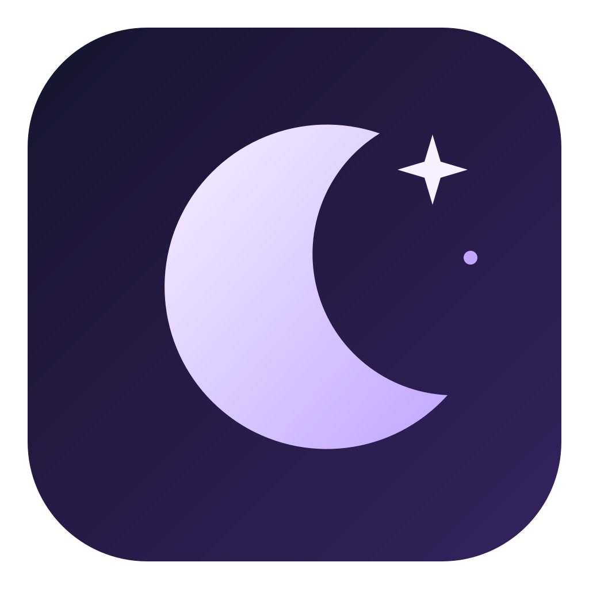

<p align="center"></p>
<h1 align="center">Try Luna</h1>
<p align="center">Try LunaOS in a virtual machine on your Mac.</p>

Try Luna is a macOS application derived from [Try Omarchy](https://github.com/omacom/try-omarchy). The first preview opens a local LunaOS x86_64 ISO using QEMU and keeps its virtual disk between launches. On Apple Silicon, x86_64 runs through emulation and will be slower than a native ARM guest.

**Current state:** there is no public LunaOS ISO release or LunaOS ARM factory image. Supply a local ISO from a trusted LunaOS build. A compiled launcher does not prove the ISO boots or installs. See [actual verification results](docs/STATUS.md).

## Build and open on macOS

You need macOS 15 or newer, Apple's Swift command-line tools and QEMU. Install the prerequisites yourself if they are missing:

```bash
xcode-select --install
brew install qemu
```

From this checkout:

```bash
make doctor
make app
open "dist/app.noindex/Try Luna.app"
```

Choose a LunaOS ISO, select RAM and CPUs, then start it. Boot tries the virtual disk first and uses the ISO when that disk is blank. After installation, close the QEMU window and use **Démarrer le disque existant** to boot the persistent virtual disk. The app never starts a VM just by opening the launcher.

`make dmg` creates an unsigned development DMG in `dist/`. No signed or notarized public download is currently available. QEMU remains a separate prerequisite for this preview.

## Command line

```bash
./try-luna doctor
./try-luna run --iso "/absolute/path/lunaos.iso" --memory 4096 --cpus 4
./try-luna run
./try-luna run --iso "/absolute/path/lunaos.iso" --dry-run
```

The default VM has its own sparse virtual disk, UEFI variable file and NAT network. Host disks, shared folders, clipboard, camera, microphone and SSH forwarding are not configured by the ISO adapter. Installing inside the VM writes its virtual disk. The original ISO remains read-only.

## Native ARM path

The upstream Swift/QEMU/Hypervisor and guest-bridge sources are retained for reuse. A real LunaOS `aarch64` factory image and its package trust chain are required before that path can ship. The launcher refuses a stock Omarchy factory as LunaOS. The preview does not claim working Retina/GPU acceleration, Touch ID, clipboard or guest integration parity.

## Development

```bash
make test
make app
make dmg
```

[Architecture](docs/luna-architecture.md) · [Status](docs/STATUS.md) · [Upstream provenance](UPSTREAM.md) · [License](LICENSE)
